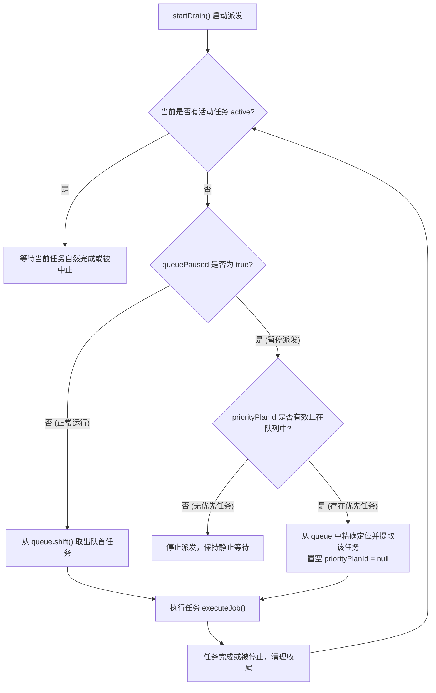

# 任务执行停止、队列暂停与手动优先调度实施方案

> 状态：待实施（第 2 轮架构完善版）。2026-11-14 根据需求访谈、架构决策与产品修订意见完成收敛。遵循 [AGENTS.md](../../AGENTS.md) 方案生命周期规范与 [0008-execution-control-and-queue-pause.md](../adr/0008-execution-control-and-queue-pause.md) 核心决策。

---

## 目录

1. [问题陈述 (Problem Statement)](#一问题陈述-problem-statement)
2. [解决方案 (Solution)](#二解决方案-solution)
3. [用户故事 (User Stories)](#三用户故事-user-stories)
4. [核心架构与实现决策 (Implementation Decisions)](#四核心架构与实现决策-implementation-decisions)
   - 4.1 [架构原则与核心边界](#41-架构原则与核心边界)
   - 4.2 [数据设计与调度状态机（最小化设计）](#42-数据设计与调度状态机最小化设计)
   - 4.3 [取消与停止的完整生命周期与资源安全](#43-取消与停止的完整生命周期与资源安全)
   - 4.4 [Windows 进程生命周期与防孤儿安全保障](#44-windows-进程生命周期与防孤儿安全保障)
   - 4.5 [并发安全、派发屏障与持久化一致性](#45-并发安全派发屏障与持久化一致性)
   - 4.6 [模块职责与接口契约](#46-模块职责与接口契约)
   - 4.7 [前端交互与顶栏感知设计](#47-前端交互与顶栏感知设计)
5. [测试决策与关键场景覆盖 (Testing Decisions)](#五测试决策与关键场景覆盖-testing-decisions)
6. [范围外说明 (Out of Scope)](#六范围外说明-out-of-scope)
7. [待实施阶段验证的技术细节](#七待实施阶段验证的技术细节)

---

## 一、问题陈述 (Problem Statement)

用户在进行视频剪辑导出（快速无损、智能降码、精确导出）或批量视频压缩时，后台转码一旦启动便完全不受控：
1. **误操作无法即时撤销**：用户选错参数或误触导出后，界面缺乏叫停手段，必须干等漫长转码结束或强行杀掉应用进程。
2. **缺乏系统资源调度弹性**：批量处理多段长视频期间，后台持续独占 CPU 与磁盘带宽。用户需要临时使用电脑进行高负载工作（如玩游戏、看视频、剪辑或开会）时，无法暂停后续任务的自动派发以腾出系统算力。
3. **缺乏暂停期间的手动优先控制**：队列暂停的实质是“暂停自动连续派发”，而非“禁止一切转码”。用户在暂停期间若急需先导出一份关键视频，目前无法在保持全局暂停的同时指定该任务单独优先执行。
4. **单任务执行进度宝贵，缺乏防误触保护**：单片剪辑或长视频压缩通常耗时很长，若缺乏二次确认机制，极易因误触【停止】按钮导致辛苦转码的进度前功尽弃。
5. **底层进程与资产清理存在安全隐患**：若直接调用操作系统杀进程，容易遗留孤儿进程或由于文件句柄尚未释放导致中间切片被锁死无法清理；且盲目清理极易误伤最终合法产物或用户原片。

---

## 二、解决方案 (Solution)

1. **单任务可控停止与两级防误触**：
   - 正在处理中（`processing`）的任务支持显式【停止导出】，带应用内模态二次确认弹窗；确认后底层按严格时序中断 FFmpeg、释放句柄并物理清除未完成的临时资产，方案持久化状态直接重置为 `ready`。
   - 排队中（`queued`）的任务支持一键【移出队列】，无进度损失，免弹窗直接移出并重置为 `ready`。
2. **全局队列调度级暂停与恢复**：
   - 顶部提供【暂停队列 / 恢复队列】控制。点击暂停后，当前活动任务继续安全跑完（不浪费既有进度），后续排队任务保持 `queued` 状态静止等待，杜绝 Windows 进程挂起造成的孤儿进程与句柄死锁；点击恢复后恢复自动派发。
   - 队列暂停状态持久化至本地，应用重启后保持暂停意图，不自动开跑抢占 CPU。
3. **暂停期间允许手动指定任务单独启动（优先调度）**：
   - 全局暂停状态下，用户可对任意排队任务点击【单独启动】。被指定任务获得下一执行优先级，**严格不解除全局队列暂停**。
   - 若当前无活动任务，立即开始执行；若当前仍有活动任务在跑，等待当前任务完成后优先执行该指定任务。
   - 指定任务完成后，引擎自动继续保持暂停状态，其他排队任务继续等待。
   - 多次指定不同任务时采用“最后一次指定获胜”，被替换的任务保留在原队列位置，零数据丢失与位置错乱。
4. **全局一键全部停止**：
   - 顶部提供【全部停止】按钮，经二次确认弹窗后，建立派发屏障，立即中止当前活动任务，清空所有普通排队任务与手动优先任务，安全回收所有临时文件并统一重置为 `ready`。
5. **顶栏多态全局状态胶囊**：
   - 顶栏常驻小巧动态胶囊，精确区分“正常导出中”、“暂停中且正在跑当前任务”、“队列已暂停”及“优先任务等待中”，点击一键直达方案中心。

---

## 三、用户故事 (User Stories)

1. 作为一名视频创作者，我想要在导出过程中发现参数设置错误时能够点击“停止导出”，以便于立即打断任务并清理垃圾文件，不用干等它转码完毕。
2. 作为一名视频创作者，我想要在对正在处理的耗时任务点击“停止”时看到二次确认弹窗，以便于防止我不小心手滑中断已经跑了很久的导出进度。
3. 作为一名批量处理视频的用户，我想要在批量压缩期间随时点击“暂停队列”，以便于让电脑暂时停止派发新任务、腾出 CPU 算力供我前台使用，同时不产生任何系统孤儿进程。
4. 作为一名批量处理视频的用户，我想要在队列暂停状态下新添加方案时它能安心在队列中等待，以便于不破坏我希望电脑保持低负载的现状。
5. 作为一名正在排队导出多个视频的用户，我想要从排队列表中快速移出某几个暂时不想导出的方案，以便于灵活调整排队顺序且无需反复弹窗确认。
6. 作为一名处于队列暂停状态下的用户，我想要能够临时挑选其中一个急需的视频点击“单独启动”，以便于优先完成这份急件，且完成后电脑依然保持暂停状态，不继续派发其余排队文件。
7. 作为一名处于队列暂停状态下的用户，若当前还有任务在跑，我点击了另一个排队视频的“单独启动”，我希望它能在当前任务跑完后立刻开始，而不打断当前任务。
8. 作为一名处于剪辑工作台或设置页面的用户，我想要在顶部栏随时看到后台任务的当前进度和排队概况，并能一键点击跳转到方案中心进行控制，以便于我无需盲目猜测后台运行状态。
9. 作为一名用户，我想要在不需要全部导出时能够一键“全部停止”，以便于快速取消当前所有排队与执行任务并恢复初始状态。

---

## 四、核心架构与实现决策 (Implementation Decisions)

### 4.1 架构原则与核心边界

1. **绝对禁止 Windows 系统级进程挂起**：
   严格遵循 [0008-execution-control-and-queue-pause.md](../adr/0008-execution-control-and-queue-pause.md)，暂停仅在调度派发层实现，不调用任何底层 `NtSuspendProcess` 或线程挂起，彻底杜绝孤儿进程、句柄死锁与必须重启电脑的技术风险。
2. **数据模型保持精简，不新增 `cancelled` 持久化状态**：
   遵循 [CONTEXT.md](../../CONTEXT.md) 的 `Execution Status` 既有规范：
   - 用户主动停止或移出队列的任务安全回收中间临时切片后恢复为 `ready`；
   - 异常中断或失败仍然记录为 `failed`；
   - 成功导出记录为 `completed`；
   - 严格不将用户的主动取消误记为执行失败，不污染错误信息。
3. **保持单任务绝对串行执行**：
   整个系统架构始终保持单任务串行执行，永远不允许并行启动多个导出 FFmpeg 任务，防止 CPU、GPU 编码器与磁盘 IO 严重争抢。

---

### 4.2 数据设计与调度状态机（最小化设计）

为了在不重构现有队列系统的前提下，高内聚、零风险地支持“暂停期间手动单独启动”，采用**指针优先标记法**，最小化设计如下：

#### A. 核心调度状态数据结构
在 `MediaCuttingEngine` 内部维护以下字段：
- `private queue: Job[] = []`：保持原有的单向任务队列；
- `private active: Job | null = null`：当前正在执行的任务；
- `private queuePaused: boolean = false`：是否处于暂停自动派发状态；
- `private priorityPlanId: string | null = null`：暂停状态下用户指定的手动优先任务 ID；
- `private drainingBarrier: Promise<void> | null = null`：全部停止时的排它派发屏障。

扩展对外广播的 `EngineState`：
```typescript
export interface EngineState {
  activePlanId: string | null;
  queuedIds: string[];
  queuePaused: boolean;          // 队列是否暂停自动派发
  priorityPlanId: string | null; // 当前指定的手动优先任务 ID（若有）
  storageError: string | null;
  progress: ExecutionProgress | null;
}
```

#### B. 调度流转状态机（Drain 算法）
每次引擎触发 `drain()` 消费任务时，严格遵循以下决策流：



**该设计的核心优势**：
1. **零数据丢失与位置安全**：优先任务依然保存在 `queue` 中，未被真正取出执行前位置不变。多次指定不同任务时，只需更新 `priorityPlanId` 指针，被替换的前优先任务自然留在原本的队列顺序中，不会发生队列元素移位或丢失。
2. **自然保持暂停语义**：当优先任务执行完毕后，进入下一次循环时 `priorityPlanId` 已为 null 且 `queuePaused === true`，引擎自然静止，其他普通排队任务继续等待，绝不意外解除全局暂停！
3. **单任务立即触发**：若当前无活动任务（空闲），用户点击【单独启动】，设置 `priorityPlanId = id` 后调用 `startDrain()`，引擎立即启动并精准抽出该任务执行。
4. **单任务延迟优先**：若当前正有任务在执行，用户点击另一个任务的【单独启动】，仅更新 `priorityPlanId = id`；当前任务结束后，下一轮 `drain()` 自动优先选中它。

#### C. 重启恢复机制
- 将 `queuePaused` 状态由 `PlanManager` 持久化在数据目录中的 `queue_state.json`；
- 应用启动时，在完成方案数据加载与未完成任务状态校验后恢复 `queuePaused`；若此前处于暂停状态，在用户主动点击【恢复队列】前，引擎禁止自动启动 `drain()`。
- 启动时若方案记录此前停留在 `queued`，恢复为排队列表；异常退出时原处于 `processing` 的任务沿用现有规则恢复为 `failed`（“上次执行中断，可重试”），不得误判为正常取消。

---

### 4.3 取消与停止的完整生命周期与资源安全

停止操作是最高优先级的破坏性控制，必须严格保证**“时序闭环、等待退出、清理隔离、成品保护”**。

#### A. 严格执行时序（8 步法定顺序）
当单任务停止或全部停止触发时，必须按以下顺序严格串行推进：

1. **阻止目标任务继续产生新工作 (Halt Pipeline)**：
   设置任务取消标记，立即拒绝派发后续分段切片、滤镜处理或拼接操作。
2. **发出对应 AbortSignal (Signal Abort)**：
   触发该任务专属的 `AbortController.abort()`。
3. **等待 FFmpeg 及相关子进程真正退出 (Wait Process Exit)**：
   等待子进程的 `close` 事件确认触发，并核验 PID 进程在操作系统中不再处于活跃状态。**绝对禁止在进程未退出时提前删除目录！**
4. **等待整个执行链异步操作彻底结束 (Await Async Chain)**：
   等待 `executeSnapshot()` 或当前正在等待的 Promise 完全落地（Settled），确保内部不再有写入操作。
5. **释放输入资源、文件句柄及缓存引用 (Release Handles & Locks)**：
   关闭所有打开的文件句柄、只读输入虚拟流，调用 `CacheMaintenanceService.release()` 释放任务目录引用。
6. **物理清理本次执行登记的未完成临时资产 (Physical Cleanup)**：
   调用 `CacheMaintenanceService.abandon(taskDirectory)` 并触发安全清理，彻底删除该任务名下的 managed 临时切片。
7. **持久化方案状态为 `ready` (Persist State)**：
   将方案持久化保存为 `status: 'ready'`，清空 `error`，更新 `updatedAt`。
8. **广播最终状态并恢复派发 (Broadcast & Resume Drain)**：
   对外发布引擎状态与方案状态变更通知，解除派发锁定，允许后续任务继续调度。

#### B. 临时资产与合法成品的安全隔离
清理范围严格按资产类型界定，禁止使用通配符或扫描输出目录：

| 资产类型 | 停止后的处理原则 | 归属与识别方式 |
|---|---|---|
| 本次任务产生的临时切片 | **物理清除** | 位于 `CacheMaintenanceService` 登记的 task managed 专属 UUID 目录下 |
| 未完成的中间视频/拼接列表 | **物理清除** | 位于上述专属 UUID 目录下，由任务容器管理 |
| 已成功发布的最终成片 | **严格保留** | 位于最终输出目录，已完成原子重命名发布，绝不触碰 |
| 用户原始素材视频 | **绝对保护** | 无论何种情况，绝对禁止任何修改或删除 |
| 其他任务的缓存或索引 | **严格保留** | 独立于本次任务容器之外，受引用计数与独立根保护 |
| 无法明确确认归属的文件 | **严格保留** | 遵循防误删安全底线，不归属本次登记的文件绝不删除 |

**发布竞态保护**：若任务已完成编码且正在执行最终文件原子发布阶段（Move/Rename），停止请求必须等待发布逻辑完成，不得在重命名中途强杀，避免留下半截损坏文件或误删成品。

---

### 4.4 Windows 进程生命周期与防孤儿安全保障

针对 Windows 平台的进程特性与 `MediaTools.ts`、`CacheMaintenanceService.ts` 的既有实现，制定以下防孤儿规范：

1. **子进程启动与登记竞态防护**：
   在 `MediaTools.runMediaTool` 中：
   - 必须在 `spawn` 调用前完成 `track.cancel` 准备；若在 `spawn` 成功但 `track.started` 尚未完成时收到取消信号，确保 `started` 回调中立即触发 `proc.kill()`，绝不允许漏登记 PID。
2. **确认进程彻底退出**：
   不能仅调用 `proc.kill()` 就假定进程已死。必须监听 `proc.on('close')`，若超时（如 2000ms）未退出，在 Windows 下使用 `taskkill /pid <PID> /T /F` 强制结束该进程树，确保无后代进程残留。
3. **主进程异常退出守护 (Process Exit Guard)**：
   在 `electron/main.ts` 的 `app.on('before-quit')` 中调用 `MediaCuttingEngine.shutdown()` 与 `stopMediaProcesses()`，遍历并强制终止所有登记中的活跃媒体子进程，确保退出时不留孤儿后台进程。
4. **子进程存活时禁止清理工作目录**：
   `CacheMaintenanceService` 的 `sweepOnce()` 必须维持现有断言：`if (entry.children.some(alive)) return;`，只要有子进程活着，一律拒绝执行文件删除操作。

---

### 4.5 并发安全、派发屏障与持久化一致性

1. **引入唯一的执行实例标识 (`runId`)**：
   每次任务被取出执行时，生成一个唯一的 `runId = Symbol()`（或 UUID）。
   所有异步回调、进度通知（`ExecutionProgress`）、子进程事件及持久化写回操作，必须严格比对当前 `activeJob.runId === runId`。若已被取消或已被新一轮执行取代，旧回调直接丢弃，彻底消除晚到回调覆盖新状态的竞态。
2. **全部停止派发屏障 (Dispatch Barrier)**：
   当用户触发【全部停止】时：
   - 建立内部屏障锁 `this.drainingBarrier`；
   - 屏障生效期间，任何新提交的 `submitDraft` 或 `executePlan` 只能写入准备列表或被排他等待，绝不进入派发流水线；
   - 先中止当前 `active` 任务，等待其完全退出与清理；
   - 同步将 `queue` 中的所有任务和 `priorityPlanId` 对应的任务全部移出，逐一重置为 `ready`；
   - 所有任务状态持久化并广播后，解除屏障锁，对外返回操作成功。
3. **保护现有持久化失败恢复机制 (`pendingFinal`)**：
   严格保留现有的 `pendingFinal` 与 `retryPendingWrites()` 语义。如果一个任务已经执行完毕进入结果保存阶段（`status: 'completed'`），此时收到取消指令，系统拒绝将其强行变为取消，而是保障已导出的成片记录被完整保存，防止重复转码。

---

### 4.6 模块职责与接口契约

#### A. `MediaCuttingEngine` 接口扩充
```typescript
export class MediaCuttingEngine {
  // 队列暂停与手动优先控制
  pauseQueue(): Promise<void>;
  resumeQueue(): void;
  isQueuePaused(): boolean;
  setPriorityPlan(planId: string): Promise<boolean>;
  getPriorityPlanId(): string | null;

  // 任务取消控制
  cancelActivePlan(id: string): Promise<{ success: boolean; message?: string }>;
  cancelQueuedPlan(id: string): boolean;
  cancelAll(): Promise<{ activeCancelled: boolean; dequeuedCount: number }>;
}
```

#### B. `PlanManager` 接口扩充
```typescript
export class PlanManager {
  pauseQueue(): Promise<void>;
  resumeQueue(): void;
  setPriorityPlan(planId: string): Promise<{ success: boolean; message?: string }>;
  cancelPlan(id: string): Promise<{ success: boolean; message?: string }>;
  cancelAllPlans(): Promise<{ success: boolean; message?: string }>;
}
```

- **`cancelPlan(id)` 实现逻辑**：
  - 若 `id === activePlanId`：由 `engine.cancelActivePlan(id)` 执行安全中断与清理，将方案状态写回 `ready` 并广播；
  - 若 `id` 在排队队列或为 `priorityPlanId`：由 `engine.cancelQueuedPlan(id)` 移出队列（若曾被指定为优先任务则同步清空 `priorityPlanId`），将方案写回 `ready` 并广播。
- **`setPriorityPlan(id)` 实现逻辑**：
  - 校验该方案必须处于 `queued` 状态；
  - 若队列尚未暂停，提示“仅在队列暂停时可指定优先执行”或仅记录意图；
  - 调用 `engine.setPriorityPlan(id)`，触发状态广播。

#### C. IPC 通信与 API 暴露 (`preload.ts` & `electronAPI`)
统一取消与控制契约，返回具备明确语义的结果对象，Renderer 不直接操作子进程或磁盘：
```typescript
interface ElectronAPI {
  // 队列与调度控制
  pauseExecutionQueue: () => Promise<void>;
  resumeExecutionQueue: () => Promise<void>;
  setPriorityExecutionPlan: (planId: string) => Promise<{ success: boolean; message?: string }>;
  
  // 停止控制
  cancelPlanExecution: (planId: string) => Promise<{ success: boolean; message?: string }>;
  cancelAllPlanExecutions: () => Promise<{ success: boolean; message?: string }>;
}
```

---

### 4.7 前端交互与顶栏感知设计

#### A. 方案中心 (`PlansPage.tsx`)
1. **顶部操作栏**：
   - **【暂停队列 / 恢复队列】按钮**：
     - 当队列处于运行状态时，显示【暂停队列】（图标：`Pause`）；
     - 当队列处于暂停状态时，高亮显示【恢复队列】（图标：`Play`，蓝底高亮）；
     - 处于暂停状态时，方案列表上方常驻柔和提示条：“⏸️ 任务队列已暂停自动派发。当前任务完成后将保持等待，您可以点击卡片上的【单独启动】优先执行特定任务，或点击‘恢复队列’继续自动处理。”
   - **【全部停止】按钮**：
     - 当存在正在处理的任务或排队任务时可用（红色警示风格）；
     - 点击触发应用内统一模态确认弹窗：“确定要停止所有正在执行和排队的任务吗？当前正在导出的任务进度将被放弃并清除临时文件。”；确认后执行。
2. **卡片内操作区**：
   - **`processing`（处理中）卡片**：
     - 显式展示红色【停止导出】按钮；
     - 点击弹出应用内模态确认弹窗：“该方案正在导出中，停止将放弃当前进度并清理临时文件，是否确定停止？”；确认后调用 `cancelPlanExecution(plan.id)`。
   - **`queued`（排队中）卡片**：
     - **【移出队列】按钮**：次级灰底按钮，点击直接移出队列回 `ready`，无弹窗。
     - **【单独启动】按钮**：
       - 当队列处于暂停状态时高亮展示（图标：`Zap` 或 `PlayCircle`，提示“暂停状态下优先执行此任务”）；
       - 点击调用 `setPriorityExecutionPlan(plan.id)`；若当前被指定为优先任务，卡片显示金色徽章“⭐ 下一个优先执行”。
   - **`ready` / `completed` / `failed` 卡片**：保留原有的执行、查看成品与重试按钮。

#### B. 全局顶栏 (`Header.tsx`)
在全局顶栏右侧（或标题旁）渲染一个紧凑的高信息量状态胶囊，精确区分为以下 4 种状态：

1. **正常批量处理中**：
   `[🔄 旋转图标] 导出中 45% (剩余 2 个排队)`
2. **已暂停，正在安全完成当前任务**：
   `[⏸️ 暂停图标] 队列暂停中 · 正在完成当前片 80%`
3. **已暂停，当前无活动任务**：
   `[⏸️ 暂停图标] 队列已暂停 (2 个任务等待)`
4. **已暂停，有手动优先任务就绪**：
   `[⭐ 星标图标] 优先待执行：[方案名]`

- **交互行为**：悬停显示 Tooltip 详情，点击胶囊无缝切换主视图 Tab 到“方案中心”（`plans`），不弹冗余抽屉层。

---

## 五、测试决策与关键场景覆盖 (Testing Decisions)

### 1. 测试标准与 Seam
- **单一最高层 Seam**：以 `MediaCuttingEngine` 及其与 `PlanManager` 的集成接口为唯一测试边界。
- **良好测试原则**：只测试公开行为（状态流转、进度广播、临时文件回收、持久化记录），不测试内部实现细节。

### 2. 关键覆盖用例清单 (14 项关键场景)

1. **排队中任务直接移出**：入队后取消，验证其立刻从队列移除，状态恢复为 `ready`，后续任务正常递进。
2. **正在处理任务中断停止**：执行转码时触发取消，验证底层 FFmpeg 进程被安全终止，临时目录碎片彻底清除，持久化状态恢复为 `ready`，无残留文件。
3. **FFmpeg 尚未退出时触发停止，不得提前清理**：验证在子进程发出 kill 信号到真正退出期间，临时目录不被提前删除，直到退出事件确认后再安全回收。
4. **FFmpeg 启动与进程登记存在竞态时触发取消**：在 spawn 尚未完成 PID 登记的极端时机触发 cancel，验证子进程启动后立即被杀死，不遗留孤儿进程。
5. **停止时持久化失败的恢复能力**：模拟取消后写回 disk 失败，验证错误被记录在 `storageError`，重试后能够正确落盘。
6. **停止后立即重新执行同一方案**：前次任务取消后立即重新提交，验证新任务获得新的 `runId`，旧任务迟到的异步回调被丢弃，不干扰新任务。
7. **队列暂停与恢复派发**：多个任务排队时调用 `pauseQueue()`，首个任务自然完成后引擎停留在暂停状态，后续任务保持 `queued`；调用 `resumeQueue()` 后恢复自动派发并依次完成。
8. **暂停期间新任务入队**：暂停状态下提交新方案，验证新方案保持 `queued`，不破坏引擎暂停状态。
9. **暂停状态下单独启动优先执行**：空闲暂停时指定排队任务，验证该任务立即开始执行，且完成后引擎继续保持暂停。
10. **当前任务执行中指定优先任务**：活动任务运行中指定优先任务，验证当前任务自然完成后，下一轮立即执行指定任务，而非原队列首位任务。
11. **连续更换手动优先任务**：连续对 A、B 两个排队任务点击单独启动，验证最终 B 优先执行，A 安全保留在原队列位置，顺序不丢失、不重复。
12. **取消手动优先任务**：对已标记为优先的任务执行取消，验证其恢复为 `ready`，`priorityPlanId` 被清空，普通队列不受影响。
13. **全部停止同时清除普通队列与优先任务**：在同时存在活动任务、普通排队任务与优先任务时调用 `cancelAll()`，验证活动任务中止清理，所有排队与优先任务全部清空回 `ready`。
14. **应用重启后恢复暂停状态与优先意图**：模拟应用重启，验证重启后 `queuePaused` 依然为 true，不自动跑任务，原排队方案完好保留。

---

## 六、范围外说明 (Out of Scope)

1. **不实现基于 Windows 系统 API 的子进程挂起**：为确保零孤儿进程风险，单任务不提供挂起。
2. **不在剪辑工作台增加控制条**：保持工作台极简，控制集中于方案中心，顶栏负责轻量感知。
3. **不建立多任务并行执行管道**：系统始终保持严格的单任务串行执行。
4. **不重构既有队列系统为复杂数据库作业队列**：采用指针优先标记法实现最小化侵入。

---

## 七、待实施阶段验证的技术细节

以下细节须在代码实施与定向测试阶段结合实际运行环境验证，不预先假定：

1. **Windows 下 `proc.kill()` 对 FFmpeg 进程树的实际回收能力**：
   在实施中需通过单元测试验证：针对未通过 shell 包装直接 spawn 的 `ffmpeg.exe`，Node 原生 `kill()` 是否能保证子进程立即退出；若存在退出延迟，核验 2000ms 超时配合 `taskkill /F /T` 作为兜底保障的可靠性。
2. **`CacheMaintenanceService` 在高频取消下的锁释放耗时**：
   验证在频繁创建、取消并清理任务目录时，NTFS 文件系统的目录删除是否存在微小延迟，确保 `abandon` 与 `sweep` 之间的时序不会因文件占用抛出 EPERM。
