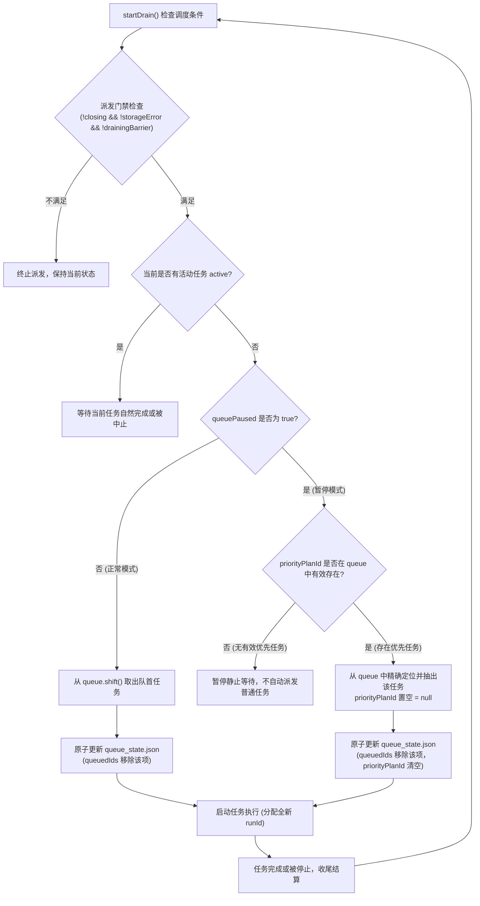

# 任务执行停止、队列暂停与手动优先调度实施方案

> 状态：待实施（第 3 轮定向审查与架构闭环版）。2026-11-14 完成第三轮深度架构核对，重点修正临时资产物理清理契约、调度状态持久化、启动恢复冲突、条件派发流转、优先任务全边界、全部停止屏障与 Windows 进程树回收保障。遵循 [AGENTS.md](../../AGENTS.md) 方案生命周期规范与 [0008-execution-control-and-queue-pause.md](../adr/0008-execution-control-and-queue-pause.md) 核心决策。

---

## 目录

1. [问题陈述 (Problem Statement)](#一问题陈述-problem-statement)
2. [解决方案 (Solution)](#二解决方案-solution)
3. [用户故事 (User Stories)](#三用户故事-user-stories)
4. [核心架构与实现决策 (Implementation Decisions)](#四核心架构与实现决策-implementation-decisions)
   - 4.1 [架构原则与核心边界](#41-架构原则与核心边界)
   - 4.2 [调度状态持久化与指针优先标记法](#42-调度状态持久化与指针优先标记法)
   - 4.3 [临时资产物理清理契约与八步法定停止时序](#43-临时资产物理清理契约与八步法定停止时序)
   - 4.4 [Windows 进程树回收与后代进程追踪](#44-windows-进程树回收与后代进程追踪)
   - 4.5 [启动恢复机制修正与现有冲突调和](#45-启动恢复机制修正与现有冲突调和)
   - 4.6 [全部停止屏障与 pendingFinal 保护机制](#46-全部停止屏障与-pendingfinal-保护机制)
   - 4.7 [手动优先任务全边界流转规则](#47-手动优先任务全边界流转规则)
   - 4.8 [模块职责与统一接口契约](#48-模块职责与统一接口契约)
   - 4.9 [前端交互与四态顶栏感知设计](#49-前端交互与四态顶栏感知设计)
5. [测试决策与关键场景覆盖 (Testing Decisions)](#五测试决策与关键场景覆盖-testing-decisions)
6. [范围外说明 (Out of Scope)](#六范围外说明-out-of-scope)
7. [待实施阶段验证的技术细节](#七待实施阶段验证的技术细节)

---

## 一、问题陈述 (Problem Statement)

用户在进行视频剪辑导出（快速无损、智能降码、精确导出）或批量视频压缩时，后台转码一旦启动便完全不受控：
1. **误操作无法即时撤销**：用户选错参数或误触导出后，界面缺乏叫停手段，必须干等漫长转码结束或强行杀掉应用进程。
2. **缺乏系统资源调度弹性**：批量处理多段长视频期间，后台持续独占 CPU 与磁盘带宽。用户需要临时使用电脑进行高负载工作（如玩游戏、看视频、剪辑或开会）时，无法暂停后续任务的自动派发以腾出系统算力。
3. **缺乏暂停期间的手动优先控制**：队列暂停的实质是“暂停自动连续派发”，而非“禁止一切转码”。用户在暂停期间若急需先导出一份关键视频，目前无法在保持全局暂停的同时指定该任务单独优先执行。
4. **单任务执行进度宝贵，缺乏防误触保护**：单片剪辑或长视频压缩通常耗时很长，若缺乏二次确认机制，极易因误触【停止】按钮导致辛苦转码的进度前功尽弃。
5. **底层进程与资产清理存在安全隐患**：若直接调用操作系统杀进程，容易遗留孤儿进程或由于文件句柄尚未释放导致中间切片被锁死无法清理；且盲目清理极易误伤最终合法产物或用户原片。

---

## 二、解决方案 (Solution)

1. **单任务可控停止与两级防误触**：
   - 正在处理中（`processing`）的任务支持显式【停止导出】，带应用内模态二次确认弹窗；确认后底层按严格法定顺序中断 FFmpeg、释放句柄、等待真实退出并物理清除未完成的临时资产，方案持久化状态直接重置为 `ready`。
   - 排队中（`queued`）的任务支持一键【移出队列】，无进度损失，免弹窗直接移出并重置为 `ready`。
2. **全局队列调度级暂停与恢复**：
   - 顶部提供【暂停队列 / 恢复队列】控制。点击暂停后，当前活动任务继续安全跑完（不浪费既有进度），后续排队任务保持 `queued` 状态静止等待，杜绝 Windows 进程挂起造成的孤儿进程与句柄死锁；点击恢复后恢复自动派发。
   - 队列状态（暂停标志、优先指针、队列顺序）持久化至本地，应用重启后保持暂停意图，不自动开跑抢占 CPU。
3. **暂停期间允许手动指定任务单独启动（优先调度）**：
   - 全局暂停状态下，用户可对任意排队任务点击【单独启动】。被指定任务获得下一执行优先级，**严格不解除全局队列暂停**。
   - 若当前无活动任务，立即开始执行；若当前仍有活动任务在跑，等待当前任务完成后优先执行该指定任务。
   - 指定任务完成后，引擎自动继续保持暂停状态，其他排队任务继续等待。
   - 多次指定不同任务时采用“最后一次指定获胜”，被替换的任务保留在原队列位置，零数据丢失与位置错乱。
4. **全局一键全部停止与排它派发屏障**：
   - 顶部提供【全部停止】按钮，经二次确认弹窗后，建立排它派发屏障，立即拒绝新任务进入流水线，中断当前活动任务，清空所有普通排队任务与手动优先任务，安全回收所有临时文件并统一重置为 `ready`；若活动任务已进入结果持久化阶段，保护已生成的合法成品。
5. **顶栏多态全局状态胶囊**：
   - 顶栏常驻小巧动态胶囊，精确区分“正常导出中”、“暂停中且正在跑当前任务”、“队列已暂停”及“优先任务等待中”，点击一键直达方案中心。

---

## 三、用户故事 (User Stories)

1. 作为一名视频创作者，我想要在导出过程中发现参数设置错误时能够点击“停止导出”，以便于立即打断任务并清理垃圾文件，不用干等它转码完毕。
2. 作为一名视频创作者，我想要在对正在处理的耗时任务点击“停止”时看到二次确认弹窗，以便于防止我不小心手滑中断已经跑了很久的导出进度。
3. 作为一名批量处理视频的用户，我想要在批量压缩期间随时点击“暂停队列”，以便于让电脑暂时停止派发新任务、腾出 CPU 算力供我前台使用，同时不产生任何系统孤儿进程。
4. 作为一名批量处理视频的用户，我想要在队列暂停状态下新添加方案时它能安心在队列中等待，以便于不破坏我希望电脑保持低负载的现状。
5. 作为一名正在排队导出多个视频的用户，我想要从排队列表中快速移出某几个暂时不想导出的方案，以便于灵活调整排队顺序且无需反复弹窗确认。
6. 作为一名处于队列暂停状态下的用户，我想要能够临时挑选其中一个急需的视频点击“单独启动”，以便于优先完成这份急件，且完成后电脑依然保持暂停状态，不继续派发其余排队文件。
7. 作为一名处于队列暂停状态下的用户，若当前还有任务在跑，我点击了另一个排队视频的“单独启动”，我希望它能在当前任务跑完后立刻开始，而不打断当前任务。
8. 作为一名处于剪辑工作台或设置页面的用户，我想要在顶部栏随时看到后台任务的当前进度和排队概况，并能一键点击跳转到方案中心进行控制，以便于我无需盲目猜测后台运行状态。
9. 作为一名用户，我想要在不需要全部导出时能够一键“全部停止”，以便于快速取消当前所有排队与执行任务并恢复初始状态。

---

## 四、核心架构与实现决策 (Implementation Decisions)

### 4.1 架构原则与核心边界

1. **绝对禁止 Windows 系统级进程挂起**：
   严格遵循 [0008-execution-control-and-queue-pause.md](../adr/0008-execution-control-and-queue-pause.md)，暂停仅在调度派发层实现，不调用任何底层 `NtSuspendProcess` 或线程挂起，彻底杜绝孤儿进程、句柄死锁与必须重启电脑的技术风险。
2. **数据模型保持精简，不新增 `cancelled` 持久化状态**：
   遵循 [CONTEXT.md](../../CONTEXT.md) 的 `Execution Status` 既有规范：
   - 用户主动停止或移出队列的任务安全回收中间临时切片后恢复为 `ready`；
   - 异常中断或失败仍然记录为 `failed`；
   - 成功导出记录为 `completed`；
   - 严格不将用户的主动取消误记为执行失败，不污染错误信息。
3. **保持单任务绝对串行执行**：
   整个系统架构始终保持单任务串行执行，永远不允许并行启动多个导出 FFmpeg 任务，防止 CPU、GPU 编码器与磁盘 IO 严重争抢。

---

### 4.2 调度状态持久化与指针优先标记法

为解决应用重启后优先任务重复、丢失或队列顺序错乱问题，建立**权威调度状态持久化机制**：

#### A. 调度状态文件 (`queue_state.json`) 格式契约
在用户数据目录（Data Directory）根下维护专用的调度状态快照文件：
```typescript
export interface PersistedQueueState {
  version: 1;
  queuePaused: boolean;          // 队列是否暂停自动派发
  priorityPlanId: string | null; // 当前指定的手动优先任务 ID（若无则为 null）
  queuedIds: string[];           // 权威普通队列的稳定有序 ID 清单
  updatedAt: string;             // ISO 时间戳
}
```

#### B. 持久化原子写入与更新时机
- **写入策略**：通过临时文件原子重命名写入（Write to `queue_state.json.tmp` -> flush/sync -> rename to `queue_state.json`），防范崩溃断电导致的半截 JSON。
- **触发更新时机**：
  1. 新任务提交入队 (`submitDraft` / `executePlan`)；
  2. 任务移出队列 (`removeQueued`)；
  3. 任务开始执行从队列中取出 (`shift` 或抽取优先任务)；
  4. 用户点击【暂停队列】或【恢复队列】；
  5. 用户指定或更换手动优先任务 (`setPriorityPlan`)；
  6. 取消手动优先任务或全部停止清空队列。

#### C. 指针优先标记法与 Drain 调度算法
`MediaCuttingEngine` 内存中保持 `queue: Job[]` 原数组物理顺序不变，仅由 `priorityPlanId` 指针指示优先执行目标：



---

### 4.3 临时资产物理清理契约与八步法定停止时序

针对 `CacheMaintenanceService.ts` 的真实实现，`abandon()` 仅将资产状态置为 `'abandoned'`，并不代表物理文件已从磁盘消失。停止任务必须严格闭环验证物理删除，不得假报成功。

#### A. 停止任务的八步法定顺序与真实物理清理契约

1. **阻止目标任务继续产生新工作 (Halt Pipeline)**：
   设置任务取消标记，立即拒绝后续分段切片、滤镜处理或拼接操作。
2. **发出对应 AbortSignal (Signal Abort)**：
   触发该任务专属的 `AbortController.abort()`。
3. **等待 FFmpeg 及相关子进程真正退出 (Wait Process Exit)**：
   等待子进程触发 `close` 事件；结合操作系统验证该 PID 及其后代进程完全消亡。
4. **等待整个执行链异步操作彻底结束 (Await Async Chain)**：
   等待 `executeSnapshot()` 或当前正在等待的 Promise 完全落地（Settled），确保内部不再有磁盘写入。
5. **释放输入资源、文件句柄及缓存引用 (Release Handles & Locks)**：
   关闭所有打开的文件句柄、只读输入虚拟流；调用 `CacheMaintenanceService.release(taskDirectory)` 释放任务目录引用。
6. **物理清理与结果核验 (Physical Cleanup & Verification)**：
   - 调用 `CacheMaintenanceService.abandon(taskDirectory)` 显式弃用该任务目录；
   - 显式调用并等待 `CacheMaintenanceService.sweep()` 完成一轮清理；
   - **真实物理删除校验**：通过 `fs.promises.stat(taskDirectory)` 核验该目录是否确实已从文件系统删除；
   - **清理失败处理**：若目录依然存在（如受 Defender 或未知锁拦截），保留该目录的资产登记与未闭环状态，记录清理警告，**绝不得假报清理已完成**，留待下次维护或启动时自动回收。
7. **持久化方案状态为 `ready` (Persist State)**：
   将方案持久化保存为 `status: 'ready'`，清空 `error`，更新 `updatedAt`。
8. **条件派发流转 (Conditional Dispatch)**：
   **绝对禁止无条件恢复自动派发！** 必须严格检查当前调度条件：
   - 若 `this.drainingBarrier` 生效中：不派发；
   - 若 `this.queuePaused === true`：
     - 若当前存在有效的 `this.priorityPlanId`：仅允许启动该优先任务；
     - 若 `this.priorityPlanId === null`：**严禁启动普通排队任务，继续保持静止等待**；
   - 若 `this.queuePaused === false` 且无阻碍：按原有队列顺序派发下一个任务。

#### B. 资产清理分类矩阵

| 资产类型 | 停止后的处理原则 | 归属与识别方式 |
|---|---|---|
| 本次任务产生的临时切片 | **物理清除** | 位于 `CacheMaintenanceService` 登记的 task managed 专属 UUID 目录下 |
| 未完成的中间视频/拼接列表 | **物理清除** | 位于上述专属 UUID 目录下，由任务容器管理 |
| 已成功发布的最终成片 | **严格保留** | 位于最终输出目录，已完成原子重命名发布，绝不触碰 |
| 用户原始素材视频 | **绝对保护** | 无论何种情况，绝对禁止任何修改或删除 |
| 其他任务的缓存或索引 | **严格保留** | 独立于本次任务容器之外，受引用计数与独立根保护 |
| 无法明确确认归属的文件 | **严格保留** | 遵循防误删安全底线，不归属本次登记的文件绝不删除 |

---

### 4.4 Windows 进程树回收与后代进程追踪

在 Windows 环境下，直接 `kill()` 或 `taskkill` 并不能天然保证子进程及其打开的文件句柄瞬间释放。必须采用严密的后代进程追踪与等待契约：

1. **子进程启动与登记竞态防护**：
   在 `MediaTools.runMediaTool` 中：
   - 必须在 `spawn` 调用前完成 `track.cancel` 准备；若在 `spawn` 成功但 `track.started` 尚未完成时收到取消信号，确保 `started` 回调中立即触发 `proc.kill()`，绝不漏登记 PID。
2. **多阶段进程退出验证**：
   - 第一阶段：向直接子进程发送终止信号（`proc.kill()`）；
   - 第二阶段：等待 `proc.on('close')` 事件（时限 1500ms）；
   - 第三阶段（兜底强杀）：若超时仍未退出，执行 `taskkill /pid <PID> /T /F` 强制清除整棵进程树；
   - 第四阶段（存活复验）：在 Windows 下通过 `alive(pid)`（调用 `process.kill(pid, 0)`）核验该 PID 确实已不在操作系统进程列表中；若仍存活，延迟 100ms 重试，最多等待 3000ms。
3. **句柄释放时差防抖**：
   子进程退出后，Windows 内核解除文件锁可能存在数毫秒到数十毫秒的时延。物理删除临时文件时若遭遇 `EPERM` 或 `EBUSY`，采用轻量指数退避重试（50ms, 150ms, 400ms），重试失败后保留登记并报告，不强行静默忽略。
4. **诚实说明系统边界（不假装绝对零孤儿）**：
   若子进程脱离作业对象且被外部不可控调试器或驱动拦截，可能产生极端脱管；方案通过进程登记持久化记录，在下一次应用启动时由 `CacheMaintenanceService` 自动核验并回收孤儿残留，确保系统具有长期自愈能力。
5. **应用退出生命周期等待 (App Quit Guard)**：
   在 Electron 主进程 `before-quit` 事件中，必须 `await MediaCuttingEngine.shutdown()` 并等待所有已登记子进程完全 close；若超出 3 秒仍未退出，统一执行进程树清理后再退出应用。

---

### 4.5 启动恢复机制修正与现有冲突调和

#### A. 现有 `PlanManager.scan(true)` 冲突与修正
**现有缺陷**：`PlanManager.ts` 中的 `scan(true)` 目前会在启动时把所有 `queued` 与 `processing` 方案一刀切地改写为 `status: 'failed', error: '上次执行中断，可重试'`，导致用户原本排队中的任务全部丢失。

**修正后的启动恢复流程**：
1. **方案记录扫描分流**：
   - 对持久化状态为 `processing` 的方案：恢复为 `status: 'failed', error: '上次执行中断，可重试'`，保留用户意图，支持重试；
   - 对持久化状态为 `queued` 的方案：**严格保持 `status: 'queued'`**，不修改为失败！
2. **调度状态快照加载 (`queue_state.json`)**：
   - 读取并校验 `queue_state.json`；若文件损坏或缺失，降级为按方案文件的 `updatedAt` 升序重构初始队列，默认恢复为 `queuePaused: true`（防误跑）；
3. **队列一致性双向交叉校验**：
   - **有效性过滤**：遍历 `queuedIds`，剔除磁盘上已不存在或状态不再是 `queued` 的 ID；
   - **孤儿排队补全**：若方案记录中有状态为 `queued` 但未出现在 `queuedIds` 中的方案，安全追加到 `queuedIds` 末尾；
   - **优先指针校验**：核验 `priorityPlanId` 是否有效存在于校验后的 `queuedIds` 中；若不存在或已不是 `queued` 状态，立即将 `priorityPlanId` 重置为 `null`；
4. **门禁控制（恢复完成前禁止派发）**：
   - 只有当上述方案扫描、状态校验与 `queue_state.json` 内存同步全部就绪后，才允许根据 `queuePaused` 状态决定是否进入 `startDrain()`。

---

### 4.6 全部停止屏障与 pendingFinal 保护机制

1. **排它派发屏障 (Dispatch Barrier)**：
   - 用户触发【全部停止】后，引擎立即建立 `this.drainingBarrier` 锁；
   - **拒绝新任务提交**：屏障生效期间，所有新发起的 `submitDraft`、`executePlan` 或 `batchExecute` 立即拒绝并抛出明确错误：“当前正在执行全部停止，未接受新任务”，**绝不暂存到待派发列表**；
   - 屏障内操作：
     - 若当前有 `active` 任务：发出中止信号，等待其退出并物理清理临时切片，将方案写回 `ready`；
     - 同步将普通队列 `queue` 与 `priorityPlanId` 中的所有任务逐一从队列移出，持久化写回 `ready`；
     - 清空 `queue_state.json` 中的 `queuedIds` 与 `priorityPlanId`；
   - 全部任务与资产清理完毕后，释放 `drainingBarrier` 锁，对外报告全部停止成功，用户恢复正常提交权限。
2. **保护 `pendingFinal` 与部分成功语义**：
   - **临界保护**：若活动任务已完成所有转码拼接，正处于结果持久化或成片发布阶段（即已赋值 `this.pendingFinal` 且 `status: 'completed'`）：
     - 严禁将该任务强行改写为取消或删除其已发布的最终成品；
     - 允许现有 `retryPendingWrites()` 继续完成该记录的持久化；
     - 全部停止此时返回具有明确事实的**部分成功语义**：`activeCancelled: false, pendingSaved: true, dequeuedCount: N, message: '当前导出任务已完成并成功保存成片，其余排队任务已全部清空'`。

---

### 4.7 手动优先任务全边界流转规则

针对各种极端与并发场景，明确以下确定性边界：

1. **指定优先任务后点击【恢复队列】**：
   - 恢复队列代表用户希望全自动派发整机任务；
   - 系统将当前被标记为 `priorityPlanId` 的任务安全移到 `queue` 队列最首位，随后清空 `priorityPlanId = null`；
   - 引擎按正常非暂停模式开始从队首自动依次派发，原优先意图被完全保全。
2. **连续指定不同任务的顺序保留**：
   - 用户先对任务 A 点击【单独启动】，随后又对任务 B 点击【单独启动】；
   - 由于采用指针标记法，任务 A 与任务 B 始终留在 `queue` 的原物理位置中；该操作仅将 `priorityPlanId` 指针从 A 变更为 B；任务 A 保留原队列位次，不丢失、不重复。
3. **重复指定同一任务的幂等性**：
   - 对已经是优先任务的方案再次点击【单独启动】，系统判定为幂等操作，不改变任何状态，不重复入队。
4. **取消优先任务后的指针清理**：
   - 若用户对当前带有“优先标记”的排队任务点击了【移出队列】：
     - 该任务被移出队列并持久化为 `ready`；
     - 系统同步将 `priorityPlanId` 置空为 `null`；
     - 队列继续保持暂停状态，绝不触发任何其他排队任务。
5. **优先任务执行期间触发【全部停止】**：
   - 一旦优先任务被抽出开始执行，其即成为当前 `active` 任务；
   - 触发全部停止时，按标准中断流程安全中止其 FFmpeg 进程并清理切片，重置为 `ready`，排队中其他任务亦全部清空。

---

### 4.8 模块职责与统一接口契约

#### A. `MediaCuttingEngine` 接口扩充
```typescript
export class MediaCuttingEngine {
  // 队列暂停与手动优先控制
  pauseQueue(): Promise<void>;
  resumeQueue(): Promise<void>;
  isQueuePaused(): boolean;
  setPriorityPlan(planId: string): Promise<{ success: boolean; message?: string }>;
  getPriorityPlanId(): string | null;

  // 任务取消控制
  cancelActivePlan(id: string): Promise<{ success: boolean; message?: string }>;
  cancelQueuedPlan(id: string): Promise<{ success: boolean; message?: string }>;
  cancelAll(): Promise<{ activeCancelled: boolean; pendingSaved?: boolean; dequeuedCount: number; message?: string }>;
}
```

#### B. `PlanManager` 接口扩充
```typescript
export class PlanManager {
  // 调度管理与持久化协同
  pauseQueue(): Promise<void>;
  resumeQueue(): Promise<void>;
  setPriorityPlan(planId: string): Promise<{ success: boolean; message?: string }>;
  
  // 停止控制
  cancelPlan(id: string): Promise<{ success: boolean; message?: string }>;
  cancelAllPlans(): Promise<{ success: boolean; activeCancelled: boolean; dequeuedCount: number; message?: string }>;
}
```

#### C. IPC 通信与 API 暴露 (`preload.ts` & `electronAPI`)
```typescript
interface ElectronAPI {
  // 调度控制
  pauseExecutionQueue: () => Promise<void>;
  resumeExecutionQueue: () => Promise<void>;
  setPriorityExecutionPlan: (planId: string) => Promise<{ success: boolean; message?: string }>;
  
  // 停止控制
  cancelPlanExecution: (planId: string) => Promise<{ success: boolean; message?: string }>;
  cancelAllPlanExecutions: () => Promise<{ success: boolean; message?: string }>;
}
```

---

### 4.9 前端交互与四态顶栏感知设计

#### A. 方案中心 (`PlansPage.tsx`)
1. **顶部操作栏**：
   - **【暂停队列 / 恢复队列】按钮**：
     - 当队列运行中：显示【暂停队列】（图标：`Pause`）；
     - 当队列已暂停：高亮显示【恢复队列】（图标：`Play`，蓝底高亮）；
     - 暂停状态常驻提示条：“⏸️ 任务队列已暂停自动派发。当前任务完成后将保持等待，您可以点击卡片上的【单独启动】优先执行特定任务，或点击‘恢复队列’继续自动处理。”
   - **【全部停止】按钮**：
     - 存在活跃任务或排队任务时可用；
     - 点击弹出应用内模态确认弹窗，确认后执行。
2. **卡片内操作区**：
   - **`processing`（处理中）卡片**：
     - 显示红色【停止导出】按钮，点击弹出二次确认弹窗，确认后调用 `cancelPlanExecution(plan.id)`。
   - **`queued`（排队中）卡片**：
     - **【移出队列】按钮**：次级灰底，点击直接移出，无弹窗。
     - **【单独启动】按钮**：
       - 当队列处于暂停状态时高亮展示（图标：`Zap`，提示“暂停状态下优先执行此任务”）；
       - 点击调用 `setPriorityExecutionPlan(plan.id)`；若已被指定为优先，卡片醒目呈现金色徽章“⭐ 下一个优先执行”。
   - **`ready` / `completed` / `failed` 卡片**：保留既有执行、打开产物目录与重试入口。

#### B. 全局顶栏 (`Header.tsx`)
顶栏右侧展示紧凑的状态胶囊，严格区分为以下 **4 种状态**：

1. **正常批量处理中**：
   `[🔄 旋转图标] 导出中 45% · 还有 2 个排队`
2. **已暂停，正在安全完成当前任务**：
   `[⏸️ 暂停图标] 队列暂停中 · 正在完成当前片 80%`
3. **已暂停，当前无活动任务（纯静止）**：
   `[⏸️ 暂停图标] 队列已暂停 · 2 个任务等待`
4. **已暂停，有手动优先任务就绪等待**：
   `[⭐ 星标图标] 优先待执行：[方案标题]`

- 点击胶囊直接无缝切换至“方案中心”（`plans`），鼠标悬停显示详细 Tooltip。

---

## 五、测试决策与关键场景覆盖 (Testing Decisions)

### 1. 测试标准与 Seam
- **单一最高层 Seam**：以 `MediaCuttingEngine` 及其与 `PlanManager` 的集成接口为唯一测试边界。
- **验证原则**：只测试公开契约与事实（状态流转、进程真正退出、临时资产真实物理删除、`queue_state.json` 内容）。

### 2. 关键覆盖用例清单 (14 项关键场景)

1. **排队中任务直接移出**：入队后调用取消，验证其立刻从队列移除，`queue_state.json` 同步剔除该 ID，状态恢复为 `ready`，后续任务正常递进。
2. **正在处理任务中断停止与真实物理清理**：执行转码时触发取消，验证底层 FFmpeg 进程被安全终止，`CacheMaintenanceService` 真实物理清除了任务临时切片目录（`fs.existsSync` 为 false），方案状态恢复为 `ready`，无残留文件。
3. **FFmpeg 尚未退出时触发停止，不得提前清理**：在子进程从发出 kill 信号到真正退出期间，验证临时目录绝对不被提前删除，直到退出事件确认后再安全回收。
4. **FFmpeg 启动与进程登记存在竞态时触发取消**：在 spawn 尚未完成 PID 登记的极端时机触发 cancel，验证子进程启动后立即被杀死，不遗留孤儿进程。
5. **停止时持久化失败的恢复能力**：模拟取消后写回 disk 失败，验证错误被记录在 `storageError`，重试后能够正确落盘。
6. **停止后立即重新执行同一方案**：前次任务取消后立即重新提交，验证新任务分配全新 `runId`，旧任务迟到的异步回调被完全丢弃，不干扰新任务。
7. **队列暂停与恢复派发**：多个任务排队时调用 `pauseQueue()`，首个任务自然完成后引擎停留在暂停状态，后续任务保持 `queued`；调用 `resumeQueue()` 后恢复自动派发并依次完成。
8. **暂停期间新任务入队**：暂停状态下提交新方案，验证新方案保持 `queued` 且更新至 `queue_state.json`，不破坏引擎暂停状态。
9. **暂停状态下单独启动优先执行**：空闲暂停时指定排队任务，验证该任务立即开始执行，且完成后引擎继续保持暂停。
10. **当前任务执行中指定优先任务**：活动任务运行中指定优先任务，验证当前任务自然完成后，下一轮立即执行指定任务，而非原队列首位任务。
11. **连续更换手动优先任务**：连续对 A、B 两个排队任务点击单独启动，验证最终 B 优先执行，A 安全保留在原队列位置，`queuedIds` 顺序不丢失、不重复。
12. **取消手动优先任务**：对已标记为优先的任务执行取消，验证其恢复为 `ready`，`priorityPlanId` 被清空，普通队列不受影响。
13. **全部停止同时清除普通队列与优先任务**：在同时存在活动任务、普通排队任务与优先任务时调用 `cancelAll()`，验证活动任务中止清理，所有排队与优先任务全部清空回 `ready`，`queue_state.json` 彻底清空。
14. **应用重启后恢复暂停状态、优先意图与队列顺序**：模拟应用重启，核验 `queue_state.json` 被正确恢复，`queuePaused` 保持为 true，原 `queued` 任务未被误改成 `failed`，原排队顺序与优先任务完整无缺。

---

## 六、范围外说明 (Out of Scope)

1. **不实现基于 Windows 系统 API 的子进程挂起**：为确保零孤儿进程风险，单任务不提供挂起。
2. **不在剪辑工作台增加控制条**：保持工作台极简，控制集中于方案中心，顶栏负责轻量感知。
3. **不建立多任务并行执行管道**：系统始终保持严格的单任务串行执行。
4. **不使用通配符或扫描目录进行清理**：严格基于资产登记容器回收。

---

## 七、待实施阶段验证的技术细节

以下细节须在代码实施与定向测试阶段结合实际运行环境验证，不预先假定：

1. **Windows 下 `taskkill /F /T` 执行后文件锁释放的微秒级延迟**：
   在实施中需通过单元测试验证：针对未通过 shell 包装直接 spawn 的 `ffmpeg.exe`，`proc.kill()` 后是否存在异步锁时延，核验防抖重试与 `CacheMaintenanceService.sweep()` 协作下的删除可靠性。
2. **高频写入 `queue_state.json` 的并发控制**：
   在批量任务频繁入队或快速出队时，验证基于原子重命名的调度状态写入是否存在极短暂的锁竞争，确保所有写入操作走既有的串行链（`this.serial`）保护。
